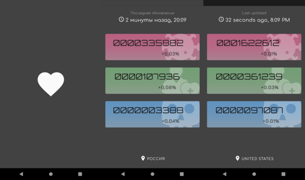

# COVID Pulse

An Android app that shows COVID-19 statistics by country: confirmed cases, recoveries and deaths, each with its daily change. Data comes from a public COVID-19 statistics API and is cached locally.

This is a pet project from spring 2020 (version 1.0.0, May 2020). It was written as a showcase of a multi-module Android architecture rather than as a store release.

<p align="center">
  
</p>

## Features

- Summary screen with confirmed, recovered and death counts and their daily change for the selected country
- Country picker dialog
- Offline-first data: the daily change is computed from the last two days stored in Room; the network is called only when that data is missing or the user forces a refresh
- Russian and English localization
- Two product flavors: `FullPulse` and `WithAddPulse`

## Architecture

The project is split into Gradle modules by layer: features depend on repositories, and repositories combine the network and database sources.

| Module | Purpose |
| --- | --- |
| `app` | Entry point, navigation graph, dependency injection setup |
| `features:summary` | Summary screen and country picker (ViewModel + data binding) |
| `data_sources:repositories:covid_stats_repo` | Repositories that combine network and cache |
| `data_sources:network:covid_stats` | Retrofit services for the statistics API |
| `data_sources:databases:main_database` | Room database |
| `libraries:ledger` | Generic cache layer on Room with expire-after-write and expire-after-read policies, exposed as `Flow` |
| `libraries:live_shared_prefs` | Observable SharedPreferences |
| `libraries:google_maps_places` | Current location and Google Maps/Places delegates |
| `libraries:firebase_auth`, `libraries:firebase_analytics` | Firebase integrations |
| `libraries:common` | Extensions, binding adapters, result wrappers |
| `buildSrc` | Versions, dependencies and Android config in Kotlin |

## Tech stack

Versions are as of May 2020.

- Kotlin 1.3.72, Coroutines 1.3.5 and Flow
- Koin 2.1.5 for dependency injection
- Retrofit 2.7.2, OkHttp 4.6.0, Gson
- Room 2.2.4, Paging 3 (early `3.0.0` snapshot)
- Jetpack Navigation 2.3 with Safe Args, data binding, Material Components
- Firebase Auth, Analytics and Crashlytics; Timber; LeakCanary in debug builds
- Gradle Kotlin DSL with `buildSrc`; detekt and ktlint for static analysis

## Building

The API address and token are not committed. Add them to `local.properties` (or pass them as Gradle properties):

```properties
apiBaseUrl="https://example.com"
apiHeaderUrlTitle="..."
apiHeaderTokenTitle="..."
apiToken="..."
isNeedCommonLog=false
isNeedOkHttpLog=false
```

Firebase also needs your own `app/google-services.json`, which is git-ignored.

The project targets Android SDK 29 (minimum SDK 21) and the Android Gradle Plugin 4.0 of that time. A current Android Studio will need the old Gradle and AGP versions, or an upgrade of the build.

## License

[Apache License 2.0](LICENSE.md)
